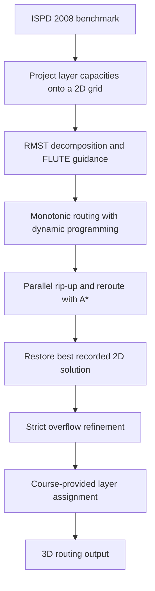

# Congestion-Aware Global Routing

A C++14 VLSI global routing project that combines dynamic programming, A* search, and OpenMP parallelism to route multi-pin nets under routing-capacity constraints. The router reads ISPD 2008 benchmark inputs, constructs and refines routes on a 2D grid, and uses the course-provided layer assignment module to produce a 3D routing solution.

## My Contribution

I implemented the routing logic in [`main.cpp`](main.cpp), building on the course-provided infrastructure and integrating FLUTE for Steiner-tree guidance. The implementation includes:

- **Multi-pin net decomposition:** Kruskal's algorithm with Manhattan-distance edge weights and disjoint-set union to construct a rectilinear minimum spanning tree (RMST) and extract two-pin connections.
- **Dynamic-programming initial routing:** congestion-aware monotonic paths, with connections processed by increasing bounding-box area and then half-perimeter wirelength.
- **A* rerouting:** a bounded-length search heuristic with congestion penalties, accumulated congestion history, and virtual demand to account for concurrent routing activity.
- **Parallel rip-up and reroute:** an OpenMP task queue that prioritizes congested connections, serializes tasks belonging to the same net, and updates shared demand with atomic operations.
- **Route refinement:** restoration of the best recorded 2D solution, followed by a stricter overflow-resolution pass that accepts replacement paths only when they fit the current 2D capacities.

The project applies graph algorithms, heuristic search, dynamic programming, and parallel programming to an electronic design automation (EDA) problem. Its rerouting approach is inspired by NCTU-GR 2.0; it is a course implementation with its own integration and tuning choices.

## Routing Pipeline



FLUTE generates a rectilinear Steiner tree whose axis-aligned branches provide preferred routing edges. The two-pin connections themselves come from the RMST decomposition. During routing, shared edges within a net can be reused without repeatedly charging that net's demand.

The main rerouting loop ranks candidates by overflow-edge count and path length. Congestion history discourages repeated use of overloaded edges, while virtual demand penalizes edges marked by other active routing tasks.

## Build and Run

### Requirements

- A C++14 compiler with OpenMP support, such as `g++`
- GNU Make
- Python 3 for the supplied verifier
- Bash and Perl only if using `run.sh`

The commands below use a Linux or WSL shell. Run them from this project's root directory: FLUTE loads `POWV9.dat` and `POST9.dat` from the current working directory.

### Build

```bash
make
```

The Makefile builds `router` with C++14, `-O3`, and OpenMP. If reusing a checkout that contains object files or an executable built on another machine, run `make clean` before rebuilding.

### Route a design

```bash
./router cases/3d.txt sample_output.gr
```

The command-line interface takes an input benchmark and an output path:

```text
./router <inputFile> <outputFile>
```

For a larger benchmark, optionally set the OpenMP thread count:

```bash
OMP_NUM_THREADS=8 ./router cases/adaptec1.gr adaptec1_output.gr
```

### Validate the output

```bash
python3 verifier.py cases/3d.txt sample_output.gr
python3 verifier.py cases/adaptec1.gr adaptec1_output.gr --json
```

The supplied Python verifier checks route legality and connectivity and reports routing metrics. Review its warnings as well as the metric values. Local evaluation uses the Python standard library; Kaggle submission is optional and is not needed for these commands.

To run the sample and all 12 benchmark cases through the existing batch script:

```bash
bash run.sh
```

This script builds the router, writes solutions into `cases/`, and evaluates them using `cases/eval2008.pl`. It overwrites the corresponding existing solution files, including `cases/3ds1.txt`.

## Evaluation

The routing objective is to reduce congestion while keeping wirelength and runtime low.

| Metric | Meaning |
| --- | --- |
| Total overflow (TOF) | Sum of demand exceeding capacity across routing edges |
| Maximum overflow (MOF) | Largest overflow on any single routing edge |
| Wirelength (WL) | Routing length reported by the evaluator, including its via-cost convention |
| Runtime | Elapsed time to generate a routing solution |

The main rerouting loop selects its best recorded solution using the internal 2D score `TOF + MOF × 10^-3 + WL × 10^-12`. Final quality should be measured on the emitted **3D output**, since layer assignment and the evaluator's accounting can change the metrics.

The included benchmark set covers `adaptec1–5`, `bigblue1–3`, and `newblue1`, `newblue2`, `newblue5`, and `newblue6`, together with the small `3d.txt` example. No benchmark performance or speedup claims are made here without a recorded run tied to this source version, hardware, and thread count.

## Implementation Notes

- **2D capacity model:** layer capacities are converted to track counts and aggregated. The current implementation uses the first net's minimum width for this conversion and unit demand per net on a 2D edge. This is an approximation for designs with varying wire widths.
- **Benchmark tuning:** several routing parameters are selected using net-count ranges associated with particular benchmarks. These are tuned presets, rather than a general parameter-learning method.
- **Runtime controls:** the main rerouting stage checks a 900-second elapsed-time threshold and allows at most 1,000 iterations. The refinement stage checks a 1,350-second elapsed-time threshold and stops when overflow no longer decreases. Both thresholds are measured from program start; they are checked between work units and do not guarantee a hard end-to-end runtime bound, especially with layer assignment afterward.
- **Parallel execution:** scheduling can affect the routing result. Record the thread count when comparing runs.

## Source Guide and Attribution

| File or component | Role and origin |
| --- | --- |
| [`main.cpp`](main.cpp) | My implementation of the 2D routing and refinement pipeline |
| [`ispdData.h`](ispdData.h) | Course-provided ISPD parser and routing data structures |
| [`LayerAssignment.cpp`](LayerAssignment.cpp), [`LayerAssignment.h`](LayerAssignment.h) | Course-provided layer assignment code derived from NCTU-GR |
| `flute*.cpp`, `flute.h`, and supporting source files | Third-party FLUTE implementation and supporting routines |
| `POWV9.dat`, `POST9.dat` | FLUTE lookup tables required at runtime |
| [`verifier.py`](verifier.py) | Course-provided route evaluation script |
| [`Makefile`](Makefile) | Build configuration; a sample Makefile was provided by the course |
| [`run.sh`](run.sh) | Batch routing and evaluation script |
| `cases/` | Benchmark inputs, existing routing outputs, and the Perl evaluator |

The parser, layer assignment module, evaluator, and FLUTE library are credited separately from my implementation in `main.cpp`.

### Reference

W.-H. Liu, W.-C. Kao, Y.-L. Li, and K.-Y. Chao, “NCTU-GR 2.0: Multithreaded Collision-Aware Global Routing With Bounded-Length Maze Routing,” *IEEE Transactions on Computer-Aided Design of Integrated Circuits and Systems*, vol. 32, no. 5, pp. 709–722, May 2013. DOI: 10.1109/TCAD.2012.2235124.
